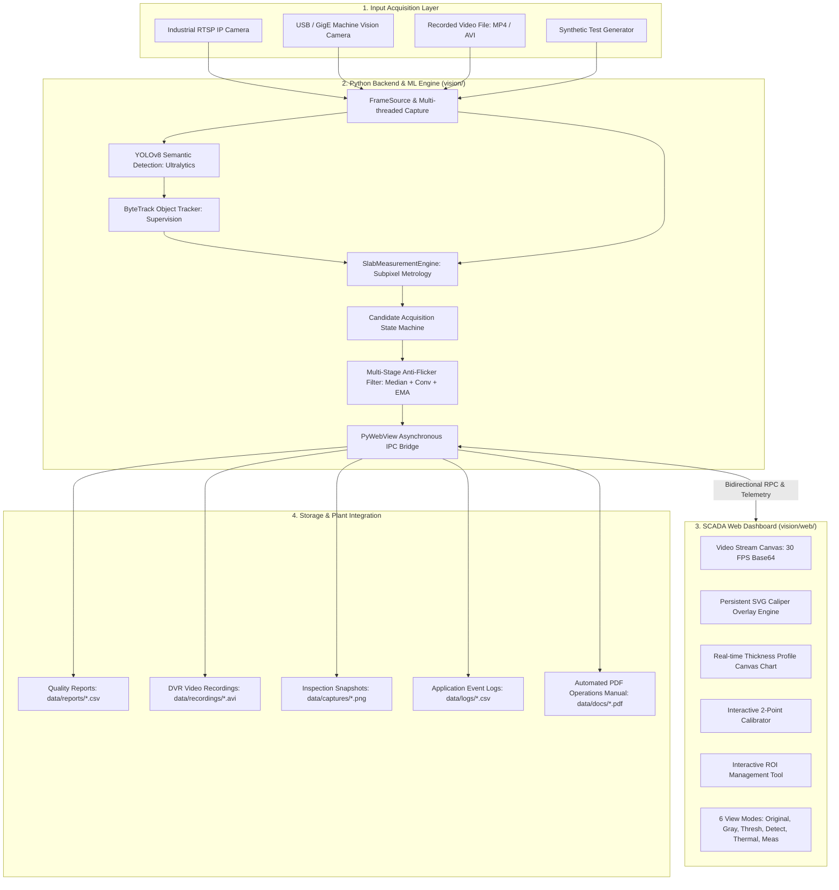

# Vision — Smart Material Management System

[](https://www.python.org/downloads/)
[](https://github.com/ADI-2707/Vision)
[](LICENSE)
[](tests/)

Industrial computer-vision platform for hot-metal slab thickness measurement, subpixel edge detection, deep learning defect/material tracking, and real-time mill material telemetry.

---

## 1. System Overview

**Vision** is a production-grade industrial computer vision and SCADA metrology platform developed by **Systrol Vision** for steel manufacturing, hot-strip mills, plate mills, and continuous casting lines. It replaces traditional manual caliper checks with high-speed automated non-contact optical thickness measurement.

The platform combines a **high-performance Python vision & deep-learning backend** with a **lightweight, zero-latency desktop SCADA web dashboard** embedded via PyWebView.



---

## 2. Machine Learning & Computer Vision Core

Vision utilizes a **hybrid architecture** combining state-of-the-art deep learning with deterministic subpixel differential calculus:

### 2.1 Deep Learning Object Detection (YOLOv8)
* Wrapped in [`vision/detector.py`](vision/detector.py) using the **Ultralytics YOLOv8** architecture (`yolov8n.pt`).
* Localizes moving metal bodies, billets, and slabs across wide-angle field of views even under dense water-descaler spray, steam plumes, and severe lighting changes.

### 2.2 Multi-Object Tracking (ByteTrack)
* Integrated in [`vision/tracker.py`](vision/tracker.py) via **Supervision**.
* Solves cross-frame identity association, maintaining persistent track IDs and motion trajectories through temporary factory occlusions.

### 2.3 Subpixel Parabolic Gradient Metrology
* Classical deep learning bounding boxes are limited to integer pixel grids. Vision implements subpixel parabolic peak fitting over Sobel vertical derivatives in [`vision/measurement.py`](vision/measurement.py):
  $$\Delta = \frac{1}{2} \cdot \frac{a - c}{a - 2b + c} \quad \implies \quad y^* = i + \Delta$$
* Resolves true physical edge boundaries down to **$0.1\text{ pixels}$**.

### 2.4 Multi-Stage Anti-Flicker & Glare Rejection
* **Flame & Glare Rejection:** Uses connected component row band segmentation to isolate dense metal bodies, rejecting turbulent furnace flames ($Y: 450 - 550\text{ px}$) and ceiling roller reflections.
* **Spatial Median Filtering (7-tap):** Eliminates localized scale flaking spikes along the edge profile.
* **Horizontal Convolution (9-tap moving average):** Smooths spatial profile across adjacent columns.
* **Temporal EMA Filter:** Holds frame-to-frame measurement jitter below **$0.30\text{ mm}$**.

For in-depth mathematical formulations and algorithms, see the **[Vision Backend README](vision/README.md)**.

---

## 3. SCADA Web Dashboard Architecture

The frontend is a zero-dependency HTML5/CSS3/JavaScript SCADA interface running in hardware-accelerated Chromium/WebKit via PyWebView:

* **Persistent SVG Caliper Engine:** Uses SVG attribute mutations rather than `innerHTML` re-rendering, eliminating DOM tearing, paint stutter, and garbage collection pauses at 60 FPS.
* **Real-Time Profile Canvas:** Renders live cross-sectional thickness profile with clamped bounds ($0 - 300\text{ mm}$), nominal Target lines, tolerance limit lines, and interactive scrubber.
* **Interactive 2-Point Calibration:** Operators click top and bottom slab edges directly on the screen to calibrate real-world millimeters per pixel ($0.34757\text{ mm/px}$ default).
* **Interactive ROI Manager:** Live drag-to-select bounding box restricting vision processing to active material zones.
* **6 Inspection Modes:** Instant toolbar switching across `ORIGINAL`, `GRAY`, `THRESHOLD`, `DETECTION`, `THERMAL` (Inferno false color), and `MEASUREMENT`.

For frontend component details and DOM binding workflows, see the **[Vision Web README](vision/web/README.md)**.

---

## 4. Repository Structure

```
Vision/
├── .github/              # GitHub Actions CI/CD workflows and automated release bump scripts
├── data/                 # Local output directories (ignored in git)
│   ├── captures/         # High-resolution PNG image snapshots
│   ├── docs/             # Generated PDF operation manuals
│   ├── logs/             # Per-frame CSV telemetry logs
│   ├── recordings/       # High-compression DVR AVI video recordings
│   └── reports/          # Timestamped quality inspection CSV reports
├── installer/            # Inno Setup Windows installer compiler scripts (VisionSetup.iss)
├── packaging/            # Application icons and desktop distribution assets
├── scripts/              # Automated build, benchmark, and verification scripts
│   ├── build_installer.bat   # Compiles standalone Windows setup executable
│   ├── build_portable.bat    # Packages portable PyInstaller single-folder bundle
│   └── verify_stability.py   # Automated 300-frame video jitter benchmark runner
├── tests/                # Automated pytest test suite (213 passing unit and regression tests)
├── vision/               # Core Python backend package (see vision/README.md)
│   ├── web/              # SCADA web dashboard frontend (see vision/web/README.md)
│   ├── bridge.py         # PyWebView RPC API and telemetry streaming thread
│   ├── capture.py        # Camera and video stream ingestion engine
│   ├── config.py         # System configuration and validation dataclass
│   ├── detector.py       # YOLOv8 deep learning detector wrapper
│   ├── measurement.py    # Subpixel edge detection and anti-jitter engine
│   ├── paths.py          # Cross-platform runtime path resolution
│   ├── pipeline.py       # End-to-end vision processing orchestrator
│   └── tracker.py        # ByteTrack multi-object tracker wrapper
├── pyproject.toml        # PEP 621 package metadata, tools, and build configuration
├── requirements.txt      # Production runtime dependency specifications
├── run.bat               # Windows one-click automated setup and launcher script
└── README.md             # Primary system documentation (this file)
```

---

## 5. Quick Start on Windows

The easiest way to start Vision is using the self-installing launcher:

1. Clone or download the repository.
2. Double-click **`run.bat`** in the project root.
3. The launcher automatically:
   * Detects Python (installs Python 3.12 via winget if missing).
   * Creates an isolated virtual environment (`.venv`).
   * Installs dependencies from `requirements.txt`.
   * Launches the Vision desktop application.

---

## 6. Manual Terminal Setup & Development

### 6.1 Create and Activate Virtual Environment

**Windows (PowerShell):**
```powershell
python -m venv .venv
.venv\Scripts\activate
```

**Linux / macOS:**
```bash
python3 -m venv .venv
source .venv/bin/activate
```

### 6.2 Install Dependencies

```bash
# Standard runtime dependencies
pip install -r requirements.txt

# Development dependencies (including pytest and build tools)
pip install -e ".[dev]"
```

### 6.3 Launching the Application

```bash
# Run with default camera (index 0)
python -m vision --source 0

# Run with an industrial RTSP stream
python -m vision --source rtsp://192.168.1.250/stream1

# Run with a recorded mill video file
python -m vision --source path/to/mill_video.mp4

# Run with a custom calibration factor (mm per pixel)
python -m vision --calibration 0.34757
```

---

## 7. Quality Assurance & Automated Testing

Vision maintains a rigorous test suite covering mathematical algorithms, edge scenarios, blank frame rejection, and frame-to-frame stability:

```bash
# Execute all 213 unit and regression tests
pytest -v

# Run the automated 300-frame video jitter benchmark
python scripts/verify_stability.py
```

* **Test Suite Status:** **`213 / 213 tests passing`**.
* **Jitter Verification:** Confirms mean frame-to-frame delta $< 0.30\text{ mm}$ on actual production video.

---

## 8. Standalone Executable & Windows Installer Build

Vision can be packaged into a standalone installer (`Vision-Setup-v1.7.0.exe`) that runs on client PCs without requiring Python to be installed:

```cmd
# 1. Compile PyInstaller portable bundle and Inno Setup installer
scripts\build_installer.bat
```

The resulting installer is saved to `dist/Vision-Setup-v1.7.0.exe`.

---

## 9. License

This project is licensed under the MIT License — see the [LICENSE](LICENSE) file for details.
