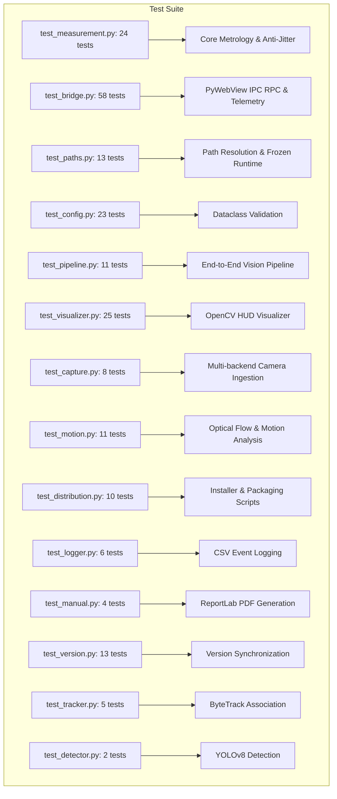

# Vision Test Suite & Quality Assurance

This directory contains the automated test suite for the Vision platform, comprising **213 test cases** across 15 test modules.

---

## 1. Test Architecture & Coverage



---

## 2. Test Modules Breakdown

| Test Module | Tests | Scope |
| :--- | :--- | :--- |
| [`test_measurement.py`](test_measurement.py) | 24 | Subpixel peak fitting, 1D spatial median filter, 9-tap convolution, temporal EMA filter, candidate acquisition state machine, blank/white frame rejection, heavy scale occlusion, and cursor boundary clamping. |
| [`test_bridge.py`](test_bridge.py) | 58 | PyWebView JavaScript API, limit synchronization, 2-point calibration, video source switching, DVR recording lifecycle, and window event handlers. |
| [`test_paths.py`](test_paths.py) | 13 | Cross-platform runtime path resolution, frozen installer checks, and `%LOCALAPPDATA%\Vision` user profile routing. |
| [`test_config.py`](test_config.py) | 23 | Type safety, range validation, and immutability of system settings. |
| [`test_pipeline.py`](test_pipeline.py) | 11 | Integration of frame ingestion, ML detection, object tracking, and metrology. |
| [`test_visualizer.py`](test_visualizer.py) | 25 | Standalone OpenCV desktop display, HUD text rendering, caliper drawing, and view mode color transforms. |
| [`test_capture.py`](test_capture.py) | 8 | DirectShow, MSMF, OpenCV VideoCapture failover, frame iteration, and resource cleanup. |
| [`test_motion.py`](test_motion.py) | 11 | Dense optical flow, motion vector estimation, and frame difference masking. |
| [`test_distribution.py`](test_distribution.py) | 10 | Inno Setup `VisionSetup.iss` configuration and packaging asset validation. |
| [`test_logger.py`](test_logger.py) | 6 | Thread-safe CSV logging and file rotation. |
| [`test_manual.py`](test_manual.py) | 4 | Automated ReportLab PDF manual generation and watermark rendering. |
| [`test_version.py`](test_version.py) | 13 | Version number alignment across Python package, installer, and frontend. |
| [`test_tracker.py`](test_tracker.py) | 5 | Supervision ByteTrack association across synthetic bounding box sequences. |
| [`test_detector.py`](test_detector.py) | 2 | Ultralytics YOLOv8 detector initialization and inference error handling. |

---

## 3. Running the Test Suite

```bash
# Run all 213 tests with standard output
.venv\Scripts\python -m pytest

# Run tests with verbose output
.venv\Scripts\python -m pytest -v

# Run only core metrology and edge detection tests
.venv\Scripts\python -m pytest tests/test_measurement.py -v

# Run with coverage reporting
.venv\Scripts\python -m pytest --cov=vision
```

---

## 4. Stability & Video Jitter Benchmark

In addition to pytest unit tests, the repository includes an automated 300-frame video benchmark in [`scripts/verify_stability.py`](../scripts/verify_stability.py):

```bash
.venv\Scripts\python scripts/verify_stability.py
```

* **Target:** Confirms that on continuous production footage, the mean frame-to-frame delta remains below **$0.30\text{ mm}$**, verifying that edge tracking is completely free of flicker.
