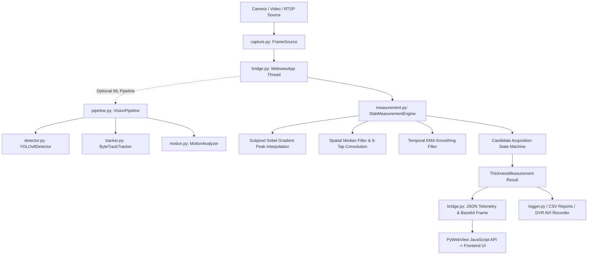
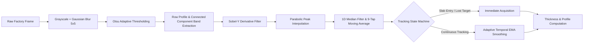

# Vision Backend & Machine Learning Engine

The `vision/` directory contains the Python core backend for the Vision Smart Material Management System. It handles industrial frame acquisition, deep learning object detection, subpixel computer vision edge tracking, multi-stage anti-flicker filtering, telemetry serialization, and the PyWebView IPC bridge.

---

## 1. Architectural Overview



---

## 2. Directory Structure & Module Responsibilities

```
vision/
├── __init__.py           # Package initialization and version definition (v1.7.0)
├── __main__.py           # CLI entry point parsing command-line flags and launching app
├── bridge.py             # PyWebView IPC bridge, RPC methods, and 30 FPS telemetry thread
├── capture.py            # Hardware camera and video file capture abstraction (DirectShow/MSMF/OpenCV)
├── config.py             # Immutable dataclass configuration with type and range validation
├── detector.py           # Deep learning object detector wrapping Ultralytics YOLOv8
├── logger.py             # Thread-safe CSV telemetry event logger
├── manual.py             # ReportLab automated PDF operation manual generator
├── measurement.py        # Core subpixel slab thickness measurement and anti-jitter engine
├── motion.py             # Frame-to-frame optical flow and motion analysis
├── paths.py              # Cross-platform runtime path resolution (development vs frozen setup)
├── pipeline.py           # Orchestrator integrating capture, detection, tracking, and measurement
├── tracker.py            # Multi-object association and tracking using Supervision ByteTrack
├── visualizer.py         # OpenCV standalone desktop visualizer and HUD renderer
└── web/                  # SCADA web dashboard frontend (HTML5/CSS3/Vanilla JS)
```

---

## 3. Computer Vision & Machine Learning Core

### 3.1 Hybrid ML + Classical Computer Vision Architecture
The platform combines deep learning localization with deterministic subpixel edge measurement:

1. **Semantic Localization (YOLOv8 & ByteTrack):**
   - [`detector.py`](detector.py): Uses Ultralytics YOLOv8 (`yolov8n.pt`) to identify moving slabs, hot billets, and material boundaries in challenging factory environments with heavy smoke, scale, and lighting changes.
   - [`tracker.py`](tracker.py): Employs ByteTrack (via `supervision`) to maintain persistent track IDs across frames even when temporary occlusions occur.

2. **Subpixel Metrology ([`measurement.py`](measurement.py)):**
   - Once the slab region is identified (or isolated via user ROI), classical differential calculus and parabolic interpolation determine the exact physical boundary with sub-pixel precision ($0.1\text{ px}$).



---

## 4. Key Mathematical Algorithms

### 4.1 Subpixel Parabolic Peak Fitting
Standard edge detection is limited to integer pixel coordinates. Vision implements 3-point parabolic peak interpolation on the Sobel vertical gradient $G_y$:

Given peak index $i$ and adjacent gradient magnitudes $a = G_y(i-1)$, $b = G_y(i)$, $c = G_y(i+1)$:

$$\Delta = \frac{1}{2} \cdot \frac{a - c}{a - 2b + c}$$

The true subpixel edge location is:
$$y^* = i + \Delta \quad \text{where } |\Delta| \le 0.5$$

This provides continuous, jitter-free boundary coordinates even when video resolution is constrained.

### 4.2 Rejection of Glare, Reflections, and Furnace Flames
Hot rolling mills produce turbulent burning flames above the metal and rolling table reflections below it. Vision isolates the dense steel slab using connected component row profiling:

1. Computes mean binary row profile:
   $$R(y) = \frac{1}{W} \sum_{x=0}^{W-1} I_{\text{thresh}}(y, x)$$
2. Segments continuous vertical components where $R(y) > 80$.
3. Enforces industrial geometric constraints ($20\text{ px} \le \text{height} \le 0.75 \cdot \text{ROI}_{\text{height}}$), rejecting isolated overhead gas flames ($Y: 450 - 550\text{ px}$) and floor reflections.

### 4.3 Multi-Stage Anti-Flicker Filtering Pipeline
Raw edge detections fluctuate due to scale flaking and thermal steam. The engine applies three cascaded filtering layers:

1. **1D Spatial Median Filter (Window size 7):** Removes impulsive edge spikes caused by localized scale flaking along the slab face.
2. **Horizontal Convolution (9-tap moving average):** Smooths the spatial profile across adjacent columns.
3. **Adaptive Temporal Exponential Moving Average (EMA):**
   $$Y_t = \alpha \cdot Y_{\text{detected}} + (1 - \alpha) \cdot Y_{t-1}$$
   - When edge detection quality is high ($\text{ratio} > 0.4$): $\alpha = 0.35$ (responsive tracking).
   - When contrast is degraded: $\alpha = 0.15$ (high inertia stability).

### 4.4 Lost-Target Acquisition vs. Continuous Tracking State Machine
A common pitfall in temporal filters is getting locked onto stale coordinates when a new slab arrives. Vision implements a dual-state machine:

* **Acquisition State:** If previous confidence was low ($< 40\%$) or no edges were found, and a new valid slab body enters the scene, the search window immediately snaps to the new candidate.
* **Tracking State:** Once high confidence is established ($\ge 40\%$), search windows tighten ($\pm 45\text{ px}$) and temporal EMA smoothing prevents frame-to-frame flicker.

### 4.5 Dimensional Calibration
Pixel measurements are converted to millimeters via a linear scaling factor:

$$C = \frac{D_{\text{known}}}{D_{\text{pixels}}} \quad (\text{mm/px})$$
$$\text{Thickness}_{\text{mm}} = (Y_{\text{bottom}} - Y_{\text{top}}) \cdot C$$

Factory default calibration for hot rolling lines is calibrated to **`0.34757 mm/px`** ($78.0\text{ mm} \approx 226\text{ px}$).

---

## 5. IPC Bridge & Telemetry Architecture ([`bridge.py`](bridge.py))

The bridge coordinates asynchronous communication between the Python vision processing loop and the PyWebView GUI:

* **Asynchronous Telemetry Loop:** Runs in a dedicated background worker thread at 30 FPS.
* **Zero-Copy Frame Encoding:** Compresses OpenCV BGR frames to Base64 JPEG and evaluates `window.updateTelemetry(payload)` in JavaScript.
* **Bidirectional RPC APIs:**
  * `set_calibration(mm_per_px)`: Updates scale across bridge and measurement engine.
  * `set_roi(x, y, w, h)`: Dynamically resizes the processing bounding box.
  * `set_limits(target, lower, upper)`: Updates quality control acceptance thresholds.
  * `set_cursor(x, y)`: Repositions inspection caliper coordinates.
  * `capture_image()`: Saves high-resolution PNG snapshots.
  * `generate_report()`: Exports full statistical CSV report with 120-point profile.
  * `toggle_recording()`: Starts/stops DVR MJPG AVI video recording.

---

## 6. Path Resolution & Production Hardening ([`paths.py`](paths.py))

To prevent Windows `PermissionError` on locked-down shop-floor PCs where `C:\Program Files\` is read-only:

* **Development Mode (`is_frozen() == False`):**
  * Logs: `data/logs/`
  * Reports: `data/reports/`
  * Captures: `data/captures/`
  * Recordings: `data/recordings/`
* **Installed Production Mode (`is_frozen() == True`):**
  * Automatically resolves all writable directories under the operator's user profile:
    `%LOCALAPPDATA%\Vision\` (`C:\Users\<User>\AppData\Local\Vision\`).
  * Guarantees non-admin plant operators can export data without permission issues.

---

## 7. Testing & Quality Assurance

The backend includes a comprehensive automated test suite in `tests/`:

```bash
# Run all backend unit and regression tests
.venv\Scripts\python -m pytest

# Run stability and frame jitter benchmark
.venv\Scripts\python scripts/verify_stability.py
```

* **Unit Tests:** Covers boundary conditions, blank/white frame rejection, dynamic ROI resize, heavy scale occlusion, and calibration math.
* **Jitter Benchmark:** Validates that 300 sequential frames maintain mean frame-to-frame delta $< 0.30\text{ mm}$.
