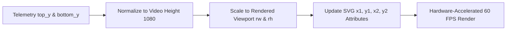
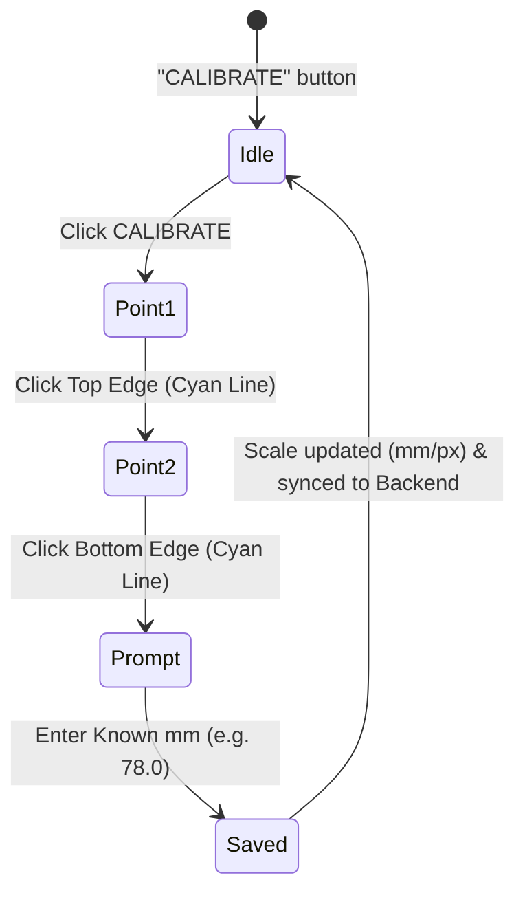

# Vision SCADA Web Frontend

The `vision/web/` directory contains the modern SCADA dashboard for the Vision Smart Material Management System. It is an ultra-fast, zero-dependency web interface built with standard HTML5, Vanilla CSS3, and JavaScript (ES6+), rendered inside a lightweight desktop window via PyWebView.

---

## 1. Architectural Overview

```mermaid
flowchart TD
    subgraph Python Backend
        A[WebviewApp Background Thread]
        B[PyWebView evaluate_js]
    end

    subgraph Frontend Runtime (Chromium / Edge WebView2)
        C[window.updateTelemetry(payload)]
        
        C --> D[Video Stream: Base64 JPEG]
        C --> E[SVG Caliper Overlay Engine: Attribute Mutation]
        C --> F[HTML5 2D Canvas: Real-Time Profile Chart]
        C --> G[DOM Telemetry Binders: Hero Numbers, Min, Max, Avg, StdDev]
        C --> H[Quality Status Banner: Normal / Out-Of-Spec / Low Confidence]
        C --> I[Interactive Limits Sync: Target, Lower, Upper]
        
        J[User Events: Clicks, Drags, Calibrate] --> K[window.pywebview.api RPC Methods]
    end

    K -->|Asynchronous IPC| A
    A -->|30 FPS Stream| B
    B --> C
```

---

## 2. Directory Structure

```
vision/web/
├── index.html            # SCADA layout structure, toolbars, viewports, cards, and modals
├── style.css             # High-contrast industrial dark/light design system with CSS custom properties
├── app.js                # Core frontend controller, SVG engine, canvas chart, and IPC bindings
├── Vision_logo.png       # Primary application vector-rendered branding logo
├── vision_mark.png       # Square application favicon and header badge
├── systrol_logo.png      # Systrol corporate engineering watermark
├── systrol_transparent.png # High-resolution transparent corporate branding watermark
├── systrol_ico_logo.png  # Systrol taskbar icon asset
└── orbix_logo.png        # Legacy product logo asset
```

---

## 3. Core UI Subsystems & Features

### 3.1 Persistent SVG Caliper Overlay Engine
Early UI prototypes suffered from flicker when using `innerHTML` teardown to re-render caliper lines on every frame. Vision uses a **persistent SVG element mutation architecture**:

* **Zero DOM Tearing:** Nodes (`<line>`, `<circle>`, `<rect>`, `<text>`) are created once via `getOrCreateSvg()` and their geometric attributes (`x1`, `y1`, `x2`, `y2`, `cx`, `cy`) are updated in-place.
* **Aspect-Ratio Coordinate Mapping:**
  The [`getVideoRenderRect()`](app.js) function accounts for letterboxing or pillarboxing in responsive layouts, mapping browser coordinates back to the native $1920 \times 1080$ video resolution:
  ```javascript
  const fx = Math.round((rawX / vRect.rw) * 1920);
  const fy = Math.round((rawY / vRect.rh) * 1080);
  ```
* **Visual Caliper Components:**
  * **Top & Bottom Boundary Lines:** Cyan horizontal guidelines tracking detected slab edges.
  * **Vertical Caliper Line:** Connects top and bottom edges at the operator's active inspection cursor.
  * **Midpoint Handles:** Yellow draggable anchor points indicating cursor placement.
  * **Floating Tooltip:** Displays live coordinate readouts ($X$, $Y$, Top, Bottom, Thickness px, and Thickness mm).



---

### 3.2 Real-Time HTML5 2D Canvas Thickness Profile Chart
Located in the lower section of the dashboard, the profile chart renders the cross-sectional shape of the slab:

* **High-Performance Canvas Rendering:** Uses `CanvasRenderingContext2D` with clamped coordinates ($0 - 300\text{ mm}$) to eliminate graph shaking and vertical bouncing.
* **Layered Graph Elements:**
  * **Grid & Labels:** 5-step horizontal division lines ($0$, $60$, $120$, $180$, $240$, $300\text{ mm}$).
  * **Target Line:** Green dashed reference line indicating nominal customer target (e.g., $78.0\text{ mm}$).
  * **Tolerance Limits:** Red dashed reference lines indicating lower and upper rejection bounds.
  * **Live Thickness Curve:** Continuous cyan curve plotting up to 120 equidistant points across the slab width.
  * **Scrubber Line:** Vertical white dashed cursor scrubber line indicating the position of the active caliper.

---

### 3.3 Interactive 2-Point Calibrator
Allows operators to calibrate real-world millimeters against video pixels directly on the screen:



1. Operator clicks **CALIBRATE** (button turns to `POINT 1: CLICK TOP`).
2. Operator clicks the **Top Edge** cyan line.
3. Button turns to `POINT 2: CLICK BOTTOM`. Operator clicks the **Bottom Edge** cyan line.
4. An input dialog appears with default target ($78.0\text{ mm}$).
5. The scale factor is computed:
   $$\text{Scale} = \frac{\text{Known mm}}{\text{Pixel Distance}} \quad (\text{mm/px})$$
6. The new scale is sent immediately to the Python backend via `window.pywebview.api.set_calibration(newScale)`.
7. Sidebar card, bottom status bar, and live thickness metrics update instantaneously.

---

### 3.4 Interactive Region of Interest (ROI) Manager
Allows operators to define the active processing bounding box:

* **Select ROI:** Click **SELECT ROI** and drag a rectangle over the video feed to define a new search area.
* **Visual Handles:** Yellow dashed rectangle with 4 corner anchor handles and a tag displaying `EDITING ROI...`.
* **Actions:**
  * **+ ADD:** Initializes a default centered ROI ($1440 \times 810$).
  * **DELETE / FULL:** Resets search area to full frame ($1920 \times 1080$).
  * **CONFIRM ROI:** Commits the rectangle and pushes `set_roi(x, y, w, h)` to the vision engine.

---

### 3.5 Six Real-Time View Modes
The top toolbar provides instant view mode switching:

| Tab | Display Mode | Inspection Purpose |
| :--- | :--- | :--- |
| **ORIGINAL** | Clean raw camera or video stream | Verifying raw optical clarity and lighting. |
| **GRAY** | Monochromatic luminance conversion | Inspecting surface scale flaking and reflections. |
| **THRESHOLD** | Binary segmented slab mask | Validating Otsu adaptive threshold segmentation. |
| **DETECTION** | Sobel vertical gradient edge map | Visualizing raw gradient transitions. |
| **THERMAL** | Inferno / Ironbow pseudo-color colormap | Thermal gradient analysis and cold spot detection. |
| **MEASUREMENT** | Caliper overlay with tolerance bounds | Standard production inspection mode. |

---

### 3.6 Bidirectional Tolerance Synchronization
The `TARGET`, `LOWER`, and `UPPER` input boxes allow operators to adjust quality limits:

* **Backend-to-Frontend Initialization:** On launch, inputs load active backend limits ($78.0\text{ mm}$, $10.0\text{ mm}$, $300.0\text{ mm}$).
* **User Input Protection:** When an operator types in an input box, a `data-user-edited` flag prevents incoming 30 FPS telemetry from overriding keystrokes.
* **Instant Sync:** On input change, `pushLimits()` dispatches `window.pywebview.api.set_limits(t, l, u)` to update backend alarm evaluation.

---

### 3.7 Operations & Data Logging Panel
* **START / STOP MEASUREMENT:** Pauses or resumes real-time edge tracking.
* **CAPTURE IMAGE:** Triggers high-resolution PNG snapshot saved to `data/captures/`.
* **GENERATE REPORT:** Exports timestamped statistical quality certificate and 120-point thickness profile to `data/reports/`.
* **RECORDING (REC):** Toggles MJPG AVI video recording with visual pulsating indicator.

---

## 4. Design System & CSS Variables ([`style.css`](style.css))

The interface implements a high-contrast industrial SCADA design with full dark/light theme support:

```css
:root, [data-theme="dark"] {
  --bg-main: #000000;
  --bg-topbar: #050505;
  --bg-card: #0a0a0a;
  --bg-input: #161616;
  --border-card: #202020;
  --border-focus: #00e5ff;
  --text-main: #f8fafc;
  --text-muted: #808080;
  --cyan-primary: #00b4d8;
  --cyan-accent: #00e5ff;
  --green-success: #00e676;
  --yellow-caliper: #ffb703;
  --red-alert: #ff334b;
  --font-sans: "Segoe UI", -apple-system, sans-serif;
  --font-mono: "Segoe UI Mono", "Cascadia Code", Consolas, monospace;
}
```
